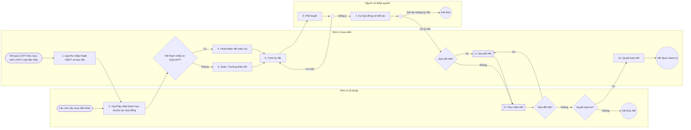
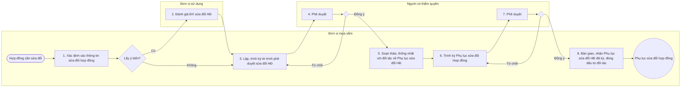

<!-- pk-source: 02. VHT gửi/Tài liệu mới nhất từ chị Thảo/QTR về hợp đồng/QTR về hợp đồng/QT.CNVTQĐ.ĐTXD.10.2.4 - Quy trinh Quan ly hop dong_2026.pdf -->
<!-- pk-sha256: 0d1c11ae48695a96eee0136719f433d1033cb24fe2f9ed3a4ea097040a4b95f6 -->
<!-- pk-manual: chuyển tay 2026-09-28 (lưu đồ vẽ lại Mermaid) — pk-md.py không sinh lại; nguồn đổi thì cập nhật tay -->

# QUY TRÌNH QUẢN LÝ HỢP ĐỒNG

> Chuyển đổi từ `QT.CNVTQĐ.ĐTXD.10.2.4 - Quy trinh Quan ly hop dong_2026.pdf` (24 trang) — 2026-09-28.
> Nội dung giữ nguyên văn bản gốc; lưu đồ được vẽ lại bằng Mermaid từ hình trong PDF.
> Ghi chú của người chuyển đổi nằm ở mục cuối, không thuộc văn bản gốc.

| Thuộc tính | Giá trị |
|---|---|
| Đơn vị ban hành | Tập đoàn Công nghiệp - Viễn thông Quân đội (Viettel) |
| Mã hiệu | QT.CNVTQĐ.ĐTXD.10.2.4 |
| Ngày ban hành | 30/06/2026 |
| Ngày có hiệu lực | 01/07/2026 |
| Ngày hết hiệu lực | — |
| Lần ban hành | 02 |
| Số trang | 23 (+ 1 trang trình ký) |
| Đơn vị trình ký | Phòng Mua sắm - Ban Đầu tư - Xây dựng - Khối cơ quan Tập đoàn |
| Thẩm định | Ban Chiến lược |

**Danh sách ký duyệt**

| STT | Người ký | Đơn vị | Thời gian ký | Ý kiến |
|---|---|---|---|---|
| 1 | Tập đoàn Công nghiệp - Viễn thông Quân đội | — | 30/06/2026 16:40:56 | Đã đóng dấu |
| 2 | Nguyễn Đạt | Phó Tổng giám đốc - Tập đoàn | 30/06/2026 09:29:43 | |
| 3 | Hoàng Văn Ngọc | Trưởng ban Chiến lược - Khối cơ quan Tập đoàn | 30/06/2026 07:33:18 | |
| 4 | Hà Quang Huy | Trưởng ban Đầu tư - Xây dựng - Khối cơ quan Tập đoàn | 29/06/2026 17:23:24 | |
| 5 | Nguyễn Trọng Tài | Chuyên viên Hợp đồng - Phòng Mua sắm - Ban Đầu tư - Xây dựng | 29/06/2026 09:32:25 | |

## Bảng theo dõi sửa đổi

| STT | Nội dung bổ sung, sửa đổi | Ngày có hiệu lực |
|---|---|---|
| 01 | Ban hành lần đầu | 03/07/2024 |
| 02 | Ban hành lần 2: - Bỏ bước 6: Đơn vị thẩm định hợp đồng (chuyển vào bước Trình ký hợp đồng) - Cập nhật đầu vào: sau khi Quyết định phê duyệt kết quả LCNT được phê duyệt theo Quy chế LCNT - Bỏ bước 10.4: Đơn vị thẩm định Tờ trình phê duyệt sửa đổi hợp đồng (chuyển vào bước Phê duyệt Tờ trình đề xuất sửa đổi hợp đồng) - Bỏ bước 10.8: Thẩm định Phụ lục sửa đổi hợp đồng (chuyển vào bước Phê duyệt Phụ lục sửa đổi hợp đồng) | 01/07/2026 |

---

## TÓM TẮT QUY TRÌNH

### I. Phạm vi điều chỉnh và đối tượng áp dụng

**1. Phạm vi:** Quy trình này thống nhất về nội dung và trình tự các bước thực hiện công việc quản lý hợp đồng mua sắm hàng hóa, dịch vụ từ soạn thảo, hoàn thiện, ký kết, thực hiện hợp đồng đến quyết toán, thanh lý hợp đồng. Đồng thời, quy trình quy định vai trò, trách nhiệm của các cơ quan, đơn vị trong việc phối hợp thực hiện công việc quản lý hợp đồng của Tập đoàn Công nghiệp – Viễn thông Quân đội.

**2. Đối tượng áp dụng:** Khối cơ quan Tập đoàn, các Tổng công ty, Công ty, Trung tâm, Viện, Học viện và các đơn vị phụ thuộc khác thuộc Tập đoàn (sau đây gọi tắt là Cơ quan, đơn vị).

### II. Tóm tắt quy trình

#### 1. Các hoạt động chính

Quy trình quản lý hợp đồng gồm **10 bước** chia thành **03 hoạt động**:

**a. Soạn thảo hợp đồng**

- ✓ *Trường hợp ký hợp đồng theo Luật đấu thầu hoặc Quy chế LCNT* (căn cứ theo quyết định phê duyệt kết quả lựa chọn nhà thầu):
  - Bước 1: Lập thư chấp thuận hồ sơ dự thầu (HSDT) và trao hợp đồng (nếu có)
  - Bước 2: Tạo/Cập nhật danh mục hàng hóa và phụ lục hợp đồng
  - Bước 4: Hoàn thiện hợp đồng, trình ký biên bản hoàn thiện hợp đồng (nếu có)
- ✓ *Trường hợp ký hợp đồng theo các nhu cầu mua sắm khác:*
  - Bước 2: Tạo/Cập nhật danh mục hàng hóa và phụ lục hợp đồng
  - Bước 3: Soạn thảo, thương thảo hợp đồng

**b. Ký hợp đồng**

- Bước 5: Trình ký hợp đồng
- Bước 6: Phê duyệt hợp đồng
- Bước 7: Ký hợp đồng với đối tác

**c. Thực hiện, thanh toán và quyết toán hợp đồng**

- Bước 8: Thực hiện hợp đồng
- Bước 9: Sửa đổi hợp đồng (nếu có)
- Bước 10: Quyết toán hợp đồng

#### 2. Các vai trò tham gia

| Tên vai trò | Mô tả nhiệm vụ |
|---|---|
| **Đơn vị mua sắm** | − Lập thư chấp thuận HSDT và trao hợp đồng (nếu có). − Soạn thảo, thương thảo hợp đồng (áp dụng đối với trường hợp hợp đồng mua sắm hàng hóa không qua đấu thầu). − Hoàn thiện hợp đồng, trình ký biên bản hoàn thiện (nếu có). − Nhận bảo lãnh thực hiện hợp đồng từ đối tác. − Trình ký người có thẩm quyền phê duyệt hợp đồng và bàn giao hợp đồng cho đối tác ký, đóng dấu. − Theo dõi và nhận lại bộ hợp đồng được hai bên ký và đóng dấu đầy đủ. − Sửa đổi hợp đồng (nếu cần), lấy ý kiến đơn vị sử dụng, phòng ban liên quan về việc thay đổi điều chỉnh nội dung hợp đồng. − Thực hiện ký biên bản quyết toán hợp đồng. |
| **Đơn vị sử dụng** | − Tạo/Cập nhật danh mục hàng hóa và phụ lục hợp đồng. − Cung cấp toàn bộ các Phụ lục hợp đồng đã thống nhất với đối tác cho đơn vị mua sắm. − Cung cấp mã hàng hóa/vật tư/thiết bị để tạo, nhập thông tin hợp đồng lên phần mềm quản lý. − Thực hiện hợp đồng. |
| **Người có thẩm quyền** | − Phê duyệt/Không phê duyệt. |

---

## NỘI DUNG QUY TRÌNH

### I. Mục đích

- Ban hành lần 2 sau khi rà soát quy trình quản lý hợp đồng để đảm bảo tính linh hoạt và phù hợp với thực tế triển khai hợp đồng tại Tập đoàn và các đơn vị;
- Quy trình được xây dựng nhằm mục đích thống nhất nội dung cụ thể, tường minh trình tự các bước thực hiện và quy định rõ vai trò, trách nhiệm của các cơ quan, đơn vị trong quá trình phối hợp quản lý hợp đồng của Tập đoàn nhằm tối ưu tiến độ thực hiện và giúp thực hiện công việc đạt hiệu quả cao nhất.

### II. Phạm vi và đối tượng áp dụng

**a. Phạm vi:** Quy trình này thống nhất về nội dung và trình tự các bước thực hiện công việc quản lý hợp đồng mua sắm hàng hóa, dịch vụ từ soạn thảo, hoàn thiện, ký kết, thực hiện đến quyết toán, thanh lý hợp đồng. Đồng thời, quy trình quy định vai trò, trách nhiệm của các cơ quan, đơn vị trong việc phối hợp thực hiện công việc quản lý hợp đồng của Tập đoàn Công nghiệp – Viễn thông Quân đội.

**b. Đối tượng áp dụng:** Khối cơ quan Tập đoàn, các Tổng công ty, Công ty, Trung tâm, Viện, Học viện và các đơn vị phụ thuộc khác thuộc Tập đoàn (sau đây gọi tắt là Cơ quan, đơn vị).

### III. Tài liệu liên quan

- Quyết định số 12868/QĐ-CNVTQĐ ngày 20/10/2025 về Ban hành Quy chế lựa chọn Nhà thầu tại Công ty mẹ - Tập đoàn Công nghiệp - Viễn thông Quân đội.
- Quyết định số 12869/QĐ-CNVTQĐ ngày 20/10/2025 và quyết định sửa đổi số 3023/QĐ-CNVTQĐ ngày 23/03/2026 về Quy chế quản lý hoạt động đầu tư tại Công ty mẹ - Tập đoàn Công nghiệp - Viễn thông Quân đội;
- Quyết định ban hành hợp đồng mẫu trong nước trong lựa chọn nhà thầu tại Tập đoàn số 14400/QĐ-CNVTQĐ ngày 20/11/2025;

### IV. Giải thích thuật ngữ, định nghĩa, khái niệm và từ viết tắt

#### 4.1. Giải thích thuật ngữ, định nghĩa, khái niệm

1. **Tập đoàn** là Tập đoàn Công nghiệp - Viễn thông Quân đội bao gồm Công ty mẹ và các đơn vị phụ thuộc.
2. **Người có thẩm quyền** là người quyết định các dự án đầu tư, khoản đầu tư hoặc người phê duyệt đề xuất mua sắm theo thẩm quyền được quy định tại Điều lệ của Tập đoàn, quyết định phân cấp, ủy quyền của Chủ tịch cho Tổng Giám đốc Tập đoàn hoặc theo các văn bản ủy quyền của Tổng Giám đốc Tập đoàn.
3. **Đơn vị mua sắm (ĐVMS)** là đơn vị được giao nhiệm vụ chủ trì việc mua sắm hàng hóa, dịch vụ.
4. **Đơn vị sử dụng (ĐVSD)** là đơn vị có nhu cầu sử dụng, đơn vị chịu trách nhiệm quản lý, khai thác, vận hành và triển khai hàng hóa, dịch vụ đã được mua sắm.
5. **Hợp đồng** là văn bản thỏa thuận giữa Tập đoàn với đối tác được lựa chọn trên cơ sở kết quả lựa chọn nhà thầu hoặc mua sắm không qua đấu thầu, được các Bên ký đóng dấu trên bản cứng hoặc trên VContract hoặc các phương tiện điện tử khác.
6. **Phụ lục sửa đổi hợp đồng**: Là văn bản được ký với đối tác thống nhất về việc sửa đổi các nội dung của hợp đồng đã ký.

#### 4.2. Từ viết tắt

| Chữ viết tắt | Ý nghĩa |
|---|---|
| R (Responsible) | Đơn vị/cá nhân chủ trì thực hiện hoạt động. |
| A (Accountable) | Đơn vị/cá nhân chịu trách nhiệm cuối cùng về việc hoàn thành hoạt động được thực hiện đúng quy trình và yêu cầu, có quyền ra quyết định và phê duyệt liên quan đến hoạt động. |
| C (Consulted) | Đơn vị/cá nhân cung cấp thông tin và tư vấn hỗ trợ trước và trong quá trình thực hiện hoạt động. |
| I (Informed) | Đơn vị/cá nhân được thông báo thông tin sau khi hoạt động được thực hiện. |
| KPIs (Key Performance Indicators) | Là các tiêu chí, chỉ số đánh giá và đo lường việc thực hiện quy trình. |

Các viết tắt khác dùng trong văn bản (không có trong bảng gốc): HSDT – hồ sơ dự thầu; HSMT – hồ sơ mời thầu; HSYC – hồ sơ yêu cầu; HSĐX – hồ sơ đề xuất; LCNT – lựa chọn nhà thầu; KQLCNT – kết quả LCNT; ĐXMS – đề xuất mua sắm; HĐ – hợp đồng.

### 5. Ranh giới quy trình

#### 5.1. Sự kiện bắt đầu và sự kiện kết thúc quy trình

- **Sự kiện bắt đầu:** Đơn vị có nhu cầu sử dụng hàng hoá sau khi Quyết định phê duyệt kết quả Lựa chọn nhà thầu (LCNT) đã được phê duyệt với trường hợp lựa chọn nhà thầu thông qua Luật đấu thầu hoặc theo Quy chế LCNT và Đề xuất mua sắm (ĐXMS) hoặc Tờ trình kinh phí đã được phê duyệt với trường hợp lựa chọn nhà thầu không thông qua đấu thầu.
- **Sự kiện kết thúc:** Hợp đồng đã được thanh lý hoặc chấm dứt.

#### 5.2. Đầu vào và đầu ra của quy trình

- **Đầu vào của quy trình:**
  - Danh mục hàng hoá dịch vụ của đơn vị, bộ phận có nhu cầu mua sắm (có ĐXMS hoặc không có ĐXMS);
  - Quyết định phê duyệt Kết quả Lựa chọn nhà thầu đã được phê duyệt;
  - Quyết định phê duyệt Kế hoạch LCNT nhà thầu đã được phê duyệt;
  - Hợp đồng mẫu trong hồ sơ mời thầu, hồ sơ yêu cầu (nếu có);
- **Đầu ra của quy trình:** Biên bản quyết toán hợp đồng (nếu có) hoặc hợp đồng được thanh lý.

### 6. Nội dung quy trình

#### 6.1. Lưu đồ quy trình

Pool "Quy trình quản lý hợp đồng", 3 lane (Đơn vị sử dụng / Đơn vị mua sắm / Người có thẩm quyền), 3 giai đoạn: *Soạn thảo hợp đồng → Ký hợp đồng → Thực hiện, thanh toán, quyết toán hợp đồng*.

> `[[...]]` = sub-process (ô có dấu ➕ trong lưu đồ gốc). Bước 8 chi tiết ở *Quy trình quản lý đơn hàng và thực hiện hợp đồng* (QT.CNVTQĐ.ĐTXD.10.2.5); Bước 9 chi tiết ở mục 6.2.

#### 6.2. Lược đồ quy trình: (Sửa đổi hợp đồng)

Pool "Sửa đổi hợp đồng", 2 giai đoạn: *Phê duyệt Tờ trình sửa đổi HĐ → Ký Phụ lục Sửa đổi hợp đồng*.

#### 6.3. Thuyết minh quy trình

| TT | Hoạt động | Mô tả chi tiết | Vai trò | Đầu vào | Đầu ra | Thời gian thực hiện | Công cụ |
|---|---|---|---|---|---|---|---|
| **Bước 1** | Lập thư chấp thuận HSDT và trao hợp đồng (Áp dụng theo từng hình thức lựa chọn Nhà thầu) | - ĐVMS lập thư chấp thuận HSDT và trao hợp đồng (nếu có), trong đó đính kèm Dự thảo hợp đồng (đã được xây dựng trong quá trình chuẩn bị hồ sơ trình ký kết quả lựa chọn nhà thầu), yêu cầu nhà thầu thực hiện biện pháp bảo đảm thực hiện hợp đồng và nộp văn bản chấp thuận đến hoàn thiện, ký kết hợp đồng. - ĐVMS gửi yêu cầu ĐVSD cập nhật danh mục hàng hóa của hợp đồng và cung cấp toàn bộ phụ lục của hợp đồng. | ĐVMS | - Quyết định phê duyệt Kết quả lựa chọn nhà thầu - HSMT/ HSDT | Thư chấp thuận HSDT và trao hợp đồng được ký | Theo các mốc thời gian, kế hoạch được phê duyệt (02 ngày) | Voffice |
| **Bước 2** | Tạo/Cập nhật danh mục hàng hóa và phụ lục hợp đồng | - ĐVSD chuẩn bị bộ phụ lục theo quy định của Dự thảo hợp đồng. - ĐVSD tạo mã cho danh mục hàng hóa của hợp đồng để nhập hợp đồng lên phần mềm quản lý. - ĐVSD gửi bảng danh mục hàng hóa (đã được cấp mã) cùng bộ phụ lục Hợp đồng cho Đơn vị mua sắm. | ĐVSD | - Quyết định phê duyệt kết quả LCNT (Trường hợp căn cứ theo KQ LCNT) - Quyết định phê duyệt kế hoạch LCNT (Ký hợp đồng trực tiếp) - ĐXMS được phê duyệt (Trường hợp căn cứ theo ĐXMS) - HSMT/HSYC - HSDT/HSĐX | Bộ hồ sơ hợp đồng được gửi cho ĐVMS gồm: - Bảng danh mục hàng hóa (đã được cấp mã) - Các Phụ lục theo quy định dự thảo hợp đồng | Theo các mốc thời gian, kế hoạch được phê duyệt (3 ngày) | VContract hoặc Hệ thống mạng đấu thầu quốc gia |
| **Bước 3** | Soạn thảo, thương thảo hợp đồng | - ĐVMS soạn thảo Dự thảo hợp đồng theo các nội dung được phê duyệt trong ĐXMS; - Đối với Hợp đồng tham chiếu theo ĐXMS, ĐVMS gửi Dự thảo Hợp đồng cùng bộ Phụ lục (kết quả ở Bước 2) cho nhà thầu để thương thảo Hợp đồng; - Thương thảo hợp đồng cùng nhà thầu; - Trình ký biên bản thương thảo; - Cập nhật, hoàn thiện Dự thảo hợp đồng theo kết quả thương thảo của Biên bản thương thảo | ĐVMS | - Bộ Dự thảo hợp đồng gồm đầy đủ các Phụ lục là kết quả của bước 2 - ĐXMS không qua đấu thầu được phê duyệt | - Biên bản thương thảo được ký và đóng dấu với đối tác - Dự thảo hợp đồng cùng các Phụ lục được thống nhất với đối tác | Theo các mốc thời gian, kế hoạch được phê duyệt (3 ngày) | VContract |
| **Bước 4** | Hoàn thiện hợp đồng (Chỉ áp dụng đối với hợp đồng căn cứ theo Luật đấu thầu) | - Hoàn thiện, thống nhất Dự thảo hợp đồng với nhà thầu - Trình ký Biên bản hoàn thiện hợp đồng (nếu có) | *(trống trong bản gốc; theo RASCI: ĐVMS = R)* | - Bộ Dự thảo hợp đồng gồm đầy đủ các Phụ lục theo quy định của hợp đồng | - Hợp đồng cùng các Phụ lục được thống nhất với nhà thầu - Biên bản hoàn thiện được ký và đóng dấu (nếu có) với nhà thầu | Theo các mốc thời gian, kế hoạch được phê duyệt (2 ngày) | VContract |
| **Bước 5** | Trình ký hợp đồng | - ĐVMS tập hợp bộ hợp đồng và các Phụ lục có đầy đủ chữ ký nháy của các đơn vị, bộ phận liên quan và nhà thầu để trình ký - ĐVMS trình ký người có thẩm quyền phê duyệt hợp đồng; | ĐVMS | Bộ hợp đồng đã được in ký nháy thống nhất với đối tác | Bộ hợp đồng đã được in ký nháy thống nhất với đối tác được trình ký | Theo các mốc thời gian, kế hoạch được phê duyệt (2 ngày) | VContract hoặc Hệ thống mạng đấu thầu quốc gia |
| **Bước 6** | Phê duyệt hợp đồng | - Người có thẩm quyền xem xét, phê duyệt hợp đồng. - Trường hợp cần thiết, Người có thẩm quyền yêu cầu các cơ quan/đơn vị chuyên môn thẩm định, kiểm tra rà soát các nội dung theo chức năng chuyên môn nhiệm vụ: đơn vị pháp chế, đơn vị tài chính, đơn vị đầu tư… thực hiện thẩm định hợp đồng, phối hợp gửi đánh giá, ý kiến/ khuyến nghị bổ sung cho ĐVMS; - Trường hợp Người có thẩm quyền không đồng ý phê duyệt hợp đồng thì sẽ quay trở về bước 5 để ĐVMS chỉnh sửa và trình ký lại hợp đồng hoặc thực hiện theo chỉ đạo của Người có thẩm quyền. | Người có thẩm quyền ký hợp đồng | Bộ hợp đồng được ĐVMS trình ký | Bộ hợp đồng được Người có thẩm quyền phê duyệt | Theo các mốc thời gian, kế hoạch được phê duyệt (6 ngày) | VContract hoặc Hệ thống mạng đấu thầu quốc gia |
| **Bước 7** | Ký hợp đồng với đối tác | - Sau khi Người có thẩm quyền phê duyệt hợp đồng, ĐVMS thực hiện bàn giao Hợp đồng (trường hợp ký cứng) hoặc gửi Hợp đồng (trường hợp ký điện tử) cho đối tác. - Trường hợp ký cứng, ĐVMS phải theo dõi đôn đốc đối tác trả bản ký đầy đủ kịp thời không ảnh hưởng tới thời gian thực hiện hợp đồng/gói thầu | Người có thẩm quyền/ ĐVMS | Bộ hợp đồng đã được người có thẩm quyền phê duyệt | Hợp đồng được ký và đóng dấu với đối tác | Theo các mốc thời gian, kế hoạch được phê duyệt (2 ngày) | VContract hoặc Hệ thống mạng đấu thầu quốc gia |
| **Bước 8** | Thực hiện hợp đồng | - Sau khi hợp đồng được ký đóng dấu với đối tác, trường hợp hợp đồng cần được sửa đổi trước khi thực hiện hợp đồng, ĐVMS thực hiện công việc sửa đổi hợp đồng như quy định ở Bước 9 của quy trình. - Trường hợp không cần sửa đổi hợp đồng ngay sau ký hợp đồng, ĐVSD chuyển sang thực hiện hợp đồng. Chi tiết về nội dung và trình tự các bước thực hiện được quy định tại Quy trình quản lý đơn hàng và thực hiện hợp đồng. - ĐVMS có trách nhiệm lưu trữ các tài liệu liên quan đến Hợp đồng theo quy định tại Luật Kế toán hiện hành. | ĐVSD | Hợp đồng được ký và đóng dấu với đối tác | Biên bản nghiệm thu kỹ thuật hợp đồng được phát hành | Theo các mốc thời gian, kế hoạch được phê duyệt | VContract hoặc Hệ thống mạng đấu thầu quốc gia |
| **Bước 9** | Sửa đổi hợp đồng | - Trong quá trình thực hiện hợp đồng, nếu trường hợp hợp đồng phát sinh nội dung cần được sửa đổi, ĐVMS xác định nội dung cần sửa đổi có thuộc trường hợp được phép sửa đổi hợp đồng theo quy định của pháp luật và/hoặc Quy chế LCNT hay không. - Việc sửa đổi hợp đồng cần tuân thủ theo quy định của pháp luật và/hoặc Quy chế LCNT. - Trường hợp nội dung cần sửa đổi được phép sửa đổi theo quy định, ĐVMS thực hiện lập và trình ký Phụ lục sửa đổi hợp đồng. Việc ký Phụ lục sửa đổi hợp đồng được thực hiện theo các bước 9.1 – 9.8 như sau: | ĐVMS | Hợp đồng cần sửa đổi | Phụ lục sửa đổi hợp đồng được ký với đối tác | Theo các mốc thời gian, kế hoạch được phê duyệt | VContract hoặc Hệ thống mạng đấu thầu quốc gia |
| **Bước 9.1** | Xác định các thông tin sửa đổi hợp đồng | - ĐVMS tiếp nhận công văn/thư thông báo của đối tác về việc đề xuất các nội dung sửa đổi hợp đồng (nếu có) hoặc Công văn đề xuất sửa đổi hợp đồng của đơn vị sử dụng (nếu có) hoặc phát sinh nhu cầu sửa đổi; - Trường hợp nội dung sửa đổi cần lấy ý kiến đánh giá từ Đơn vị sử dụng, ĐVMS lấy ý kiến đánh giá của ĐVSD về các nội dung sửa đổi đó. Trường hợp không cần lấy ý kiến đánh giá của ĐVSD, ĐVMS chuyển sang thực hiện tiếp Bước 9.3 của Quy trình. | ĐVMS | - Hợp đồng có nội dung cần sửa đổi - Văn bản của đối tác đề xuất sửa đổi hợp đồng | Các thông tin sửa đổi hợp đồng được xác định | Theo các mốc thời gian, kế hoạch được phê duyệt | Voffice |
| **Bước 9.2** | Đánh giá đề xuất sửa đổi hợp đồng (nếu cần) | - ĐVSD đánh giá các nội dung sửa đổi hợp đồng (nếu cần). - ĐVSD gửi báo cáo cho ĐVMS đánh giá và đề xuất tính phù hợp của các nội dung sửa đổi. - ĐVMS thống nhất các nội dung sửa đổi với Đơn vị sử dụng; | ĐVSD/ ĐVMS | - Yêu cầu đánh giá nội dung sửa đổi của ĐVMS | Báo cáo đánh giá về các nội dung sửa đổi | Theo các mốc thời gian, kế hoạch được phê duyệt | Voffice |
| **Bước 9.3** | Lập, trình ký tờ trình phê duyệt sửa đổi hợp đồng | - ĐVMS lập Tờ trình đề xuất sửa đổi hợp đồng và trình Người có thẩm quyền phê duyệt | ĐVMS | - Các nội dung sửa đổi hợp đồng được thống nhất | - Tờ trình phê duyệt đề xuất sửa đổi hợp đồng được trình ký đơn vị thẩm định | Theo các mốc thời gian, kế hoạch được phê duyệt | Voffice |
| **Bước 9.4** | Phê duyệt Tờ trình đề xuất sửa đổi hợp đồng | - Người có thẩm quyền xem xét, ký duyệt Tờ trình đề xuất sửa đổi hợp đồng. - Trường hợp cần thiết, Người có thẩm quyền yêu cầu các cơ quan/đơn vị chuyên môn thẩm định, kiểm tra rà soát các nội dung theo chức năng chuyên môn nhiệm vụ; - Trường hợp người có thẩm quyền phê duyệt hợp đồng không đồng ý phê duyệt Tờ trình đề xuất sửa đổi hợp đồng thì sẽ quay trở về bước 9.3 để ĐVMS chỉnh sửa và trình ký lại Tờ trình đề xuất sửa đổi hợp đồng hoặc thực hiện theo chỉ đạo của Người có thẩm quyền. | Người có thẩm quyền | Tờ trình phê duyệt đề xuất sửa đổi hợp [đồng] được trình ký | Tờ trình đề xuất sửa đổi hợp đồng được Người có thẩm quyền phê duyệt | Theo các mốc thời gian, kế hoạch được phê duyệt | Voffice |
| **Bước 9.5** | Soạn thảo, thống nhất với đối tác về Phụ lục sửa đổi hợp đồng | - ĐVMS soạn thảo Phụ lục sửa đổi hợp đồng căn cứ theo các nội dung đã được phê duyệt trong Tờ trình đề xuất sửa đổi hợp đồng và thống nhất nội dung với đối tác | *(trống trong bản gốc)* | Tờ trình đề xuất sửa đổi hợp đồng được phê duyệt | Dự thảo Phụ lục sửa đổi hợp đồng đã được thống nhất với đối tác | Theo các mốc thời gian, kế hoạch được phê duyệt | VContract hoặc Hệ thống mạng đấu thầu quốc gia |
| **Bước 9.6** | Trình ký Phụ lục sửa đổi Hợp đồng | - ĐVMS tập hợp Phụ lục sửa đổi hợp đồng và các Phụ lục đính kèm Phụ lục sửa đổi từ ĐVSD (nếu có) để trình ký. - ĐVMS sửa, hoàn thiện hồ sơ trình ký khi Người có thẩm quyền không phê duyệt; Trình ký lại Phụ lục sửa đổi hợp đồng sau khi hoàn thiện. | ĐVMS | Phụ lục sửa đổi hợp đồng và các phụ lục đính kèm (nếu có) đã được thống nhất với đối tác | Phụ lục sửa đổi hợp đồng và các phụ lục đính kèm (nếu có) đã thống nhất với đối tác được trình ký | Theo các mốc thời gian, kế hoạch được phê duyệt | VContract hoặc các phương tiện điện tử khác |
| **Bước 9.7** | Phê duyệt Phụ lục sửa đổi hợp đồng | - Người có thẩm quyền xem xét, ký Phụ lục sửa đổi hợp đồng - Trường hợp Người có thẩm quyền không đồng ý phê duyệt Phụ lục sửa đổi hợp đồng thì sẽ quay trở về bước 9.6 để ĐVMS chỉnh sửa và trình ký lại Phụ lục sửa đổi hợp đồng hoặc thực hiện theo chỉ đạo của người có thẩm quyền. | Người có thẩm quyền | Phụ lục sửa đổi hợp đồng được trình ký | Phụ lục sửa đổi hợp đồng được Người có thẩm quyền phê duyệt | Theo các mốc thời gian, kế hoạch được phê duyệt | VContract hoặc Hệ thống mạng đấu thầu quốc gia |
| **Bước 9.8** | Bàn giao và theo dõi nhận Phụ lục sửa đổi hợp đồng đã ký, đóng dấu từ đối tác | - Sau khi Người có thẩm quyền phê duyệt Phụ lục sửa đổi hợp đồng, ĐVMS bàn giao Phụ lục sửa đổi (trường hợp ký cứng) hoặc gửi Phụ lục sửa đổi (trường hợp ký điện tử) cho đối tác. - Trường hợp ký cứng, ĐVMS phải theo dõi đôn đốc đối tác trả bản ký đầy đủ kịp thời không ảnh hưởng tới thời gian thực hiện hợp đồng/gói thầu. | ĐVMS | Phụ lục sửa đổi hợp đồng đã được Người có thẩm quyền phê duyệt | Phụ lục sửa đổi hợp đồng được ký và đóng dấu với đối tác | Theo các mốc thời gian, kế hoạch được phê duyệt | *(trống trong bản gốc)* |
| **Bước 10** | Quyết toán hợp đồng (nếu có) | - ĐVMS trình ký Biên bản quyết toán hợp đồng. - Đối với hợp đồng quy định việc tự động thanh lý hợp đồng, ĐVMS theo dõi hợp đồng đến khi hợp đồng được thanh lý. Trường hợp hợp đồng quy định việc ký biên bản thanh lý, ĐVMS trình ký Biên bản thanh lý hợp đồng. | ĐVMS | - Hợp đồng đã ký; - Biên bản nghiệm thu kỹ thuật hợp đồng | - Biên bản quyết toán hợp đồng được ký với đối tác. - Biên bản thanh lý hợp đồng được ký với đối tác (Đối với hợp đồng quy định ký biên bản thanh lý) hoặc Hợp đồng được tự động thanh lý. | Theo các mốc thời gian, kế hoạch được phê duyệt | VContract |

#### 6.4. Vai trò các bên liên quan — Ma trận phân quyền (RASCI)

| TT | Hoạt động | Đơn vị mua sắm | Đơn vị sử dụng | Người có thẩm quyền |
|---|---|---|---|---|
| 1 | Lập thư chấp thuận HSDT và trao Hợp đồng | R | | |
| 2 | Tạo/Cập nhật danh mục hàng hóa và Phụ lục hợp đồng | I, C | R | |
| 3 | Soạn thảo, thương thảo hợp đồng | R | C | |
| 4 | Hoàn thiện hợp đồng, trình ký biên bản hoàn thiện hợp đồng (nếu có) | R | C | |
| 5 | Trình ký Hợp đồng | R | I, C | |
| 6 | Phê duyệt Hợp đồng | | | A |
| 7 | Ký hợp đồng với đối tác | R | I | A |
| 8 | Thực hiện Hợp đồng | I, C | R | |
| 9 | Sửa đổi Hợp đồng | R | I, C | A |
| 10 | Quyết toán Hợp đồng | R | I, C | |

#### 6.5. KPI đánh giá các hoạt động trong quy trình

| STT | Tên KPI | Cách tính | Mục tiêu (Target) | Tần suất đánh giá | Đơn vị chịu trách nhiệm đảm bảo KPI | Đơn vị đánh giá |
|---|---|---|---|---|---|---|
| 1 | KPI về thời gian ký hợp đồng với đối tác | = Thời gian trung bình để hoàn thành ký hợp đồng với đối tác (kể từ ngày phê duyệt QĐ KQLCNT đến ngày ký hợp đồng hoặc ĐXMS, Tờ trình kinh phí được duyệt đến ngày ký hợp đồng) | 20 ngày | Năm | Đơn vị mua sắm | Bộ phận kế hoạch đơn vị |
| 2 | KPI về thời gian thực hiện hợp đồng | = Tỷ lệ hợp đồng có thời gian thực hiện thực tế không vượt quá thời gian thực hiện quy định trong hợp đồng | Tối thiểu 90% | Năm | Đơn vị mua sắm | Bộ phận kế hoạch đơn vị |

#### 6.5. Rủi ro và chốt kiểm soát

*(Đánh số "6.5" lặp lại như bản gốc.)*

| STT | Các sự kiện rủi ro nhận diện | Nguyên nhân | Biện pháp kiểm soát tương ứng | Loại kiểm soát: Tự động/Bán tự động/Thủ công | Loại kiểm soát: Phòng ngừa/Phát hiện với cùng tần suất giao dịch/Phát hiện với tần suất thấp hơn tần suất giao dịch |
|---|---|---|---|---|---|
| 1 | Dự thảo hợp đồng có các nội dung khác Hợp đồng mẫu đính kèm HSMT/ HSĐX | Trong quá trình hoàn thiện Hợp đồng, Đơn vị bổ sung/ điều chỉnh các nội dung nhưng không được quy định trong HSMT/ HSĐX | Đơn vị mua sắm phải đảm bảo tuân thủ đúng nội dung của hợp đồng mẫu và HSMT/HSĐX, không bổ sung các nội dung không được quy định khác trừ khi các nội dung đó đã được thống nhất với nhà thầu trong biên bản thương thảo/biên bản hoàn thiện hợp đồng. | Thủ công | Phòng ngừa |
| 2 | Giữa hợp đồng mẫu và HSMT/HSĐX đã phát hành có những nội dung không đồng nhất | Sai sót trong quá trình lập HSMT | Đơn vị lập dự thảo hợp đồng phát hiện điểm không đồng nhất cần làm rõ trong biên bản thương thảo/ hoàn thiện với nhà thầu. | Thủ công | Phòng ngừa |
| 3 | Người ký hợp đồng của nhà thầu không có thẩm quyền/ ủy quyền ký hợp đồng => Hợp đồng không có giá trị pháp lý | Do người đứng tên ký hợp đồng của nhà thầu không được ủy quyền ký hợp đồng hoặc ủy quyền đã hết hạn. | Đơn vị thẩm định cần kiểm tra tính đúng đắn của ủy quyền cho người ký hợp đồng của nhà thầu. | Thủ công | Phòng ngừa |
| 4 | Hợp đồng có điều khoản không còn phù hợp với thực tế hoặc quy định pháp luật | Do Thời điểm thực hiện không còn phù hợp | Điều chỉnh hợp đồng cho phù hợp với quy định pháp luật | Thủ công | Phòng ngừa |
| 5 | Chậm tiến độ hợp đồng | Nhà thầu chậm trễ hoàn trả hợp đồng, dẫn đến kéo dài thời gian triển khai thực hiện hợp đồng | Bám nắm tiến độ, đôn đốc đối tác triển khai thực hiện ngay sau khi hợp đồng được các Bên ký kết. | Thủ công | Phòng ngừa |

### 7. Biểu mẫu/Tài liệu hướng dẫn đính kèm

Không có.

---

## Ghi chú chuyển đổi (không thuộc văn bản gốc)

- **Nguồn:** PDF ký số trên Voffice, có watermark chéo (mã NV + tên người xem); watermark đã được loại khi trích xuất.
- **Các ô bảng bị cắt qua trang** trong PDF (Bước 2, 3, 6, 8, 9, 9.2, 9.6) đã được ghép lại thành một dòng.
- **Điểm không nhất quán trong bản gốc** (giữ nguyên, chỉ ghi nhận):
  - Đầu ra Bước 9.3 vẫn ghi "trình ký đơn vị thẩm định", trong khi Bảng sửa đổi lần 2 nói bước thẩm định tờ trình đã được gộp vào Bước 9.4 (phê duyệt).
  - Bảng sửa đổi lần 2 nhắc "bước 10.4 / 10.8" (đánh số của bản lần 1); ở bản lần 2 phần sửa đổi là Bước 9.x.
  - Cột "Vai trò" của Bước 4 và Bước 9.5, cột "Công cụ" của Bước 9.8 để trống.
  - Hai mục cùng đánh số "6.5" (KPI và Rủi ro).
- **Liên kết:** Bước 8 dẫn sang [Quy trình quản lý Đơn hàng và thực hiện Hợp đồng](QT.CNVTQĐ.ĐTXD.10.2.5%20-%20Quy%20trinh%20quan%20ly%20Don%20hang%20va%20thuc%20hien%20Hop%20dong.%202026.md).
