<!-- pk-source: 02. VHT gửi/Tài liệu mới nhất từ chị Thảo/QTR về hợp đồng/QTR về hợp đồng/QT.CNVTQĐ.ĐTXD.10.2.5 - Quy trinh quan ly Don hang va thuc hien Hop dong. 2026.pdf -->
<!-- pk-sha256: 0bf774aec9c2d1282bd5d666db38beca8c07b3d3d4e2719b68b7f1a8bcc10518 -->
<!-- pk-manual: chuyển tay 2026-09-28 (lưu đồ vẽ lại Mermaid) — pk-md.py không sinh lại; nguồn đổi thì cập nhật tay -->

# QUY TRÌNH QUẢN LÝ ĐƠN HÀNG VÀ THỰC HIỆN HỢP ĐỒNG

> Chuyển đổi từ `QT.CNVTQĐ.ĐTXD.10.2.5 - Quy trinh quan ly Don hang va thuc hien Hop dong. 2026.pdf` (24 trang) — 2026-09-28.
> Nội dung giữ nguyên văn bản gốc; lưu đồ được vẽ lại bằng Mermaid từ hình trong PDF.
> Ghi chú của người chuyển đổi nằm ở mục cuối, không thuộc văn bản gốc.

| Thuộc tính | Giá trị |
|---|---|
| Đơn vị ban hành | Tập đoàn Công nghiệp - Viễn thông Quân đội (Viettel) |
| Mã hiệu | QT.CNVTQĐ.ĐTXD.10.2.5 |
| Ngày ban hành | 30/06/2026 |
| Ngày có hiệu lực | 01/07/2026 |
| Ngày hết hiệu lực | — |
| Lần ban hành | 03 |
| Số trang | 23 (+ 1 trang trình ký) |
| Đơn vị trình ký | Phòng Mua sắm - Ban Đầu tư - Xây dựng - Khối cơ quan Tập đoàn |
| Thẩm định | Ban Chiến lược |
| Quy trình cha | [QT.CNVTQĐ.ĐTXD.10.2.4 – Quy trình quản lý hợp đồng](QT-10.2.4.md) (chi tiết hoá Bước 8 "Thực hiện hợp đồng") |

**Danh sách ký duyệt**

| STT | Người ký | Đơn vị | Thời gian ký | Ý kiến |
|---|---|---|---|---|
| 1 | Tập đoàn Công nghiệp - Viễn thông Quân đội | — | 30/06/2026 19:06:06 | Đã đóng dấu |
| 2 | Nguyễn Đạt | Phó Tổng giám đốc - Tập đoàn | 30/06/2026 09:30:06 | |
| 3 | Hoàng Văn Ngọc | Trưởng ban Chiến lược - Khối cơ quan Tập đoàn | 30/06/2026 07:33:25 | |
| 4 | Hà Quang Huy | Trưởng ban Đầu tư - Xây dựng - Khối cơ quan Tập đoàn | 29/06/2026 17:22:53 | |
| 5 | Nguyễn Trọng Tài | Chuyên viên Hợp đồng - Phòng Mua sắm - Ban Đầu tư - Xây dựng | 29/06/2026 09:32:15 | |

## Bảng theo dõi sửa đổi

| STT | Nội dung bổ sung, sửa đổi | Ngày có hiệu lực |
|---|---|---|
| 01 | Ban hành lần đầu | 05/08/2024 |
| 02 | Ban hành lần 2: Bước 4B_Cập nhật mã con nhằm mục đích phân rõ trách nhiệm của các đơn vị, bộ phận trong quá trình phối hợp thực hiện quy trình | 16/12/2024 |
| 03 | Ban hành lần 3: - Bổ sung bước 4c: Tạo PO mới cho việc thay đổi, điều chỉnh thành mã hàng mới - Cập nhật mô tả chi tiết bước 2_Tạm ứng | 01/07/2026 |

---

## TÓM TẮT QUY TRÌNH

### I. Phạm vi điều chỉnh và đối tượng áp dụng

**1. Phạm vi:** Quy trình này thống nhất về nội dung và trình tự các bước thực hiện công việc quản lý đơn hàng và thực hiện hợp đồng. Đồng thời, quy trình quy định vai trò, trách nhiệm của các cơ quan, đơn vị trong việc phối hợp thực hiện công việc quản lý các hợp đồng, đơn hàng của Tập đoàn Công nghiệp – Viễn thông Quân đội.

**2. Đối tượng áp dụng:** Khối cơ quan Tập đoàn, các Tổng công ty, Công ty, Trung tâm, Viện, Học viện và các đơn vị phụ thuộc khác thuộc Tập đoàn (sau đây gọi tắt là Cơ quan, đơn vị).

### II. Tóm tắt quy trình

#### 1. Các hoạt động chính

Quy trình thực hiện hợp đồng gồm **16 bước**, chia thành **4 giai đoạn**:

**1.1. Lập Đơn hàng (PO) trên phần mềm quản lý**

- Bước 1: Tạo Hợp đồng và PO
- Bước 2: Thanh toán tạm ứng

**1.2. Nhập kho**

- Bước 3a: Thực hiện xác nhận dịch vụ
- Bước 3b: Thực hiện Nghiệm thu dịch vụ
- Bước 4a: Tiếp nhận hàng hoá
- Bước 4b: Cập nhật mã cha con
- Bước 4c: Tạo PO mới sau cập nhật mã hàng
- Bước 5: Tạo Yêu cầu nhập kho
- Bước 6: Nhập kho hàng hóa

**1.3. Nghiệm thu**

- Bước 7: Tạo Phiếu yêu cầu KCS
- Bước 8: Kiểm tra đánh giá chất lượng hàng hoá
- Bước 9a: Phê duyệt Biên bản bàn giao tổng hợp hàng hoá (HOC)
- Bước 9b: Sửa đổi hợp đồng
- Bước 9c: Đổi/trả hàng hoá sai khác cho Nhà cung cấp/ Nhà thầu
- Bước 10: Triển khai lắp đặt, nghiệm thu

**1.4. Thanh toán hợp đồng/ đơn hàng**

- Bước 11: Thanh toán cho Nhà thầu/NCC

#### 2. Các vai trò tham gia

| Tên vai trò | Mô tả nhiệm vụ |
|---|---|
| **Đơn vị mua sắm** | − Thực hiện hợp đồng và sửa đổi hợp đồng (nếu có) và quyết toán hợp đồng. − Cấp thông tin số mã hiệu gói thầu, mã dự án. Chủ trì tạo PO trên hệ thống quản lý: duyệt/hủy PO, cập nhật mã PO − Tổng hợp báo cáo đánh giá cho phép nhập kho − Trình ký/phê duyệt biên bản HOC − Trình ký/phê duyệt Biên bản quyết toán hợp đồng/đơn hàng |
| **Đơn vị sử dụng** | − Thực hiện tiếp nhận hàng hoá, vật tư thiết bị và phối hợp với bộ phận kho trả hàng cho NCC/NT nếu có sai khác; − ĐVSD chịu trách nhiệm và chủ động phối hợp với bộ phận kho xác định mã hàng và phân bổ tỷ trọng đơn giá dựa trên thực tế hàng hóa bàn giao theo nhu cầu cần quản lý − Làm thủ tục Nhập-xuất kho hàng hóa − Kiểm tra đánh giá chất lượng hàng hóa, thực hiện đánh giá lại hàng hoá nếu có sai khác so với chỉ tiêu của hợp đồng và đưa ra đề xuất; − Triển khai lắp đặt hàng hóa và nghiệm thu kỹ thuật − Thực hiện xác nhận dịch vụ, nghiệm thu dịch vụ hoàn thành − Trình cấp có thẩm quyền phê duyệt Biên bản/Chứng nhận nghiệm thu kỹ thuật |
| **Bộ phận tài chính kế toán** | − Duyệt tạo PO trên hệ thống quản lý − Duyệt YCCT tạm ứng, duyệt thanh toán hợp đồng/đơn hàng cho Nhà thầu/NCC |

---

## NỘI DUNG QUY TRÌNH

### I. Mục đích

- Quy trình được xây dựng nhằm mục đích tường minh trình tự các bước thực hiện và quy định vai trò, trách nhiệm của đơn vị trong quá trình phối hợp quản lý đơn hàng và thực hiện hợp đồng của Tập đoàn nhằm tối ưu hóa tiến độ thực hiện và giúp thực hiện công việc đạt hiệu quả cao nhất.

### II. Phạm vi và đối tượng áp dụng

**1. Phạm vi:** Quy trình này thống nhất về nội dung, trình tự các bước thực hiện trong quản lý đơn hàng và thực hiện hợp đồng từ khi hợp đồng/đơn hàng mua sắm được ký đóng dấu, đưa vào triển khai thực hiện, đến khi kết thúc gồm: tạo Hợp đồng/PO trên phần mềm quản lý, thực hiện nhập - xuất kho hàng hóa, thực hiện kiểm tra/ nghiệm thu hàng hóa đến khi quyết toán thanh lý hợp đồng.

**2. Đơn vị áp dụng:** Khối cơ quan Tập đoàn, các Tổng Công ty, Công ty, Trung tâm, Viện, Học viện và các đơn vị phụ thuộc khác thuộc Tập đoàn (sau đây gọi tắt là cơ quan, đơn vị).

### III. Tài liệu liên quan

- Quy trình quản lý hợp đồng số QT.CNVTQĐ.ĐTXD.10.2.4 ngày 03/07/2024
- Quy trình nhập - xuất kho số QT.CNVTQĐ.ĐTXD.10.4.2 ngày 03/07/2024
- Quy trình kiểm tra đánh giá chất lượng sản phẩm, hàng hoá mua sắm mới tại VTNet số QT.VTNET.KCS.03 ký ngày 28/06/2024;
- Quy trình thanh toán các hợp đồng mua sắm cho các dự án đầu tư và SXKD của các đơn vị do Tập đoàn ký hợp đồng số QT.CNVTQĐ.TCKT.8.6.3b ngày 02/01/2025;

### IV. Giải thích thuật ngữ, định nghĩa, khái niệm và từ viết tắt

#### 1. Giải thích định nghĩa, thuật ngữ viết tắt và khái niệm

- **Tập đoàn** là Tập đoàn Công nghiệp - Viễn thông Quân đội bao gồm: Công ty mẹ và các đơn vị phụ thuộc.
- **Đơn vị mua sắm (ĐVMS)** là đơn vị được giao nhiệm vụ chủ trì việc mua sắm hàng hóa, dịch vụ.
- **Đơn vị sử dụng (ĐVSD)** là đơn vị có nhu cầu sử dụng, đơn vị chịu trách nhiệm quản lý, khai thác, vận hành và triển khai hàng hóa, dịch vụ đã được mua sắm.
- **Bộ phận Tài chính kế toán**: là kế toán thanh toán thuộc Ban Tài chính Kế toán, Trung tâm dịch vụ dùng chung hoặc Phòng Tài chính Kế toán các đơn vị hoặc Bộ phận tài chính tại đơn vị mua sắm theo chức năng nhiệm vụ được duyệt.
- **Hợp đồng** là văn bản thỏa thuận giữa Tập đoàn với đối tác được lựa chọn trên cơ sở kết quả lựa chọn nhà thầu hoặc mua sắm không qua đấu thầu, được các Bên ký đóng dấu trên bản cứng hoặc trên VContract hoặc các phương tiện điện tử khác.
- **Phụ lục sửa đổi hợp đồng**: Là văn bản thỏa thuận giữa Tập đoàn với Nhà thầu thống nhất về việc sửa đổi các nội dung của hợp đồng đã ký.

#### 2. Từ viết tắt

| Chữ viết tắt | Ý nghĩa |
|---|---|
| R (Responsible) | Đơn vị/cá nhân chủ trì thực hiện hoạt động. |
| A (Accountable) | Đơn vị/cá nhân chịu trách nhiệm cuối cùng về việc hoàn thành hoạt động được thực hiện đúng quy trình và yêu cầu, có quyền ra quyết định và phê duyệt liên quan đến hoạt động. |
| C (Consulted) | Đơn vị/cá nhân cung cấp thông tin và tư vấn hỗ trợ trước và trong quá trình thực hiện hoạt động. |
| I (Informed) | Đơn vị/cá nhân được thông báo thông tin sau khi hoạt động được thực hiện. |
| S (Support) | Đơn vị/cá nhân hỗ trợ trước, trong và sau quá trình thực hiện hoạt động. |
| KPIs (Key Performance Indicators) | Là các tiêu chí, chỉ số đánh giá và đo lường việc thực hiện quy trình. |

| Chữ viết tắt | Tên đầy đủ |
|---|---|
| ĐVMS | Đơn vị mua sắm |
| ĐVSD | Đơn vị sử dụng |
| BBBG | Biên bản bàn giao |
| BBKT | Biên bản kiểm tra |
| HĐ | Hợp đồng |
| HOC | Biên bản bàn giao hàng hóa tổng thể (Hand-over Certificate) |
| TAM | Biên bản ghi nhớ kiểm tra kỹ thuật (Technical Acceptance Memorandum) |
| PAC | Biên bản kiểm tra kỹ thuật sơ bộ (Provisional Acceptance Certificate) |
| TAT | Biên bản kiểm tra kỹ thuật giai đoạn TAC (Technical Acceptance Test for the TAC) |
| TAC | Biên bản/Chứng nhận nghiệm thu kỹ thuật (Technical Acceptance Certificate) |
| FAC | Biên bản nghiệm thu kỹ thuật cuối cùng (Final Acceptance Certificate) |
| KCS | Kiểm tra chất lượng sản phẩm |
| PO | Đơn hàng nội bộ được tạo trên phần mềm quản lý |
| YCNK | Yêu cầu nhập kho |
| CTKT | Chỉ tiêu kỹ thuật |
| NT/NCC | Nhà thầu/ Nhà cung cấp |
| BOM | Cấu trúc danh mục hàng hoá |

Viết tắt khác dùng trong văn bản (không có trong bảng gốc): YCCT – yêu cầu chuyển tiền; TCKT – tài chính kế toán; SAP – phần mềm quản trị doanh nghiệp; SXKD – sản xuất kinh doanh.

### 5. Ranh giới quy trình

#### 5.1. Sự kiện bắt đầu và sự kiện kết thúc quy trình

- **Sự kiện bắt đầu:** Hợp đồng/ đơn hàng đã được đại diện có thẩm quyền của các Bên phê duyệt và có hiệu lực.
- **Sự kiện kết thúc:** Hàng hóa, dịch vụ được ĐVSD tiếp nhận đã nghiệm thu kỹ thuật.

#### 5.2. Đầu vào và đầu ra của quy trình

- **Đầu vào của quy trình:** Hợp đồng/ đơn hàng đã ký kết và có hiệu lực.
- **Đầu ra của quy trình:**
  - Biên bản/Chứng nhận nghiệm thu kỹ thuật (PAC/TAM, FAC/TAC) được phê duyệt (đối với hàng hóa);
  - Biên bản nghiệm thu sử dụng dịch vụ được phê duyệt (đối với dịch vụ).

### 6. Nội dung quy trình

#### 6.1. Lưu đồ quy trình

Pool "Quy trình quản lý đơn hàng và thực hiện hợp đồng", 3 lane (Bộ phận tài chính kế toán / ĐVSD / ĐVMS), 4 giai đoạn: *Tạo đơn hàng và tạm ứng (nếu có) → Nhập kho → Nghiệm thu → Thanh toán*.

```mermaid
flowchart LR
  subgraph TCKT["Bộ phận tài chính kế toán"]
    B2["2. Tạm ứng"]
    GNT{" "}
    B11[["11. Thanh toán cho Nhà thầu/NCC"]]
    END(("Kết thúc Hợp đồng"))
  end
  subgraph DVSD["ĐVSD"]
    B3a["3a. Xác nhận dịch vụ"]
    B3b["3b. Nghiệm thu dịch vụ"]
    B4a["4a. Nhận hàng"]
    GMA{" "}
    B4b["4b. Cập nhật mã cha con"]
    B6[["6. Quy trình nhập kho"]]
    B8["8. Kiểm tra đánh giá Chất lượng"]
    GCL{"Hàng hoá đạt chất lượng?"}
    GCN{" "}
    B9c["9c. Trả hàng cho NCC/NT"]
    GHUY{"Huỷ hợp đồng?"}
    EHUY(("Kết thúc"))
    GJ{" "}
    PAR{{"+ song song"}}
    B10["10. Triển khai lắp đặt, nghiệm thu"]
    DOC[/"BB nghiệm thu (PAC/TAM, FAC/TAC) được phê duyệt"/]
  end
  subgraph DVMS["ĐVMS"]
    S(["HĐ đã ký"])
    B1["1. Tạo HĐ và PO"]
    GTU{"Có tạm ứng không?"}
    GLOAI{" "}
    B4c["4c. Tạo PO mới sau cập nhật mã hàng"]
    B5["5. Tạo YCNK"]
    B7["7. Tạo yêu cầu KCS"]
    B9b[["9b. Quy trình sửa đổi HĐ"]]
    B9a["9a. Biên bản HOC"]
  end
  S --> B1 --> GTU
  GTU -- Có --> B2
  GTU -- Không --> GLOAI
  B2 -- "Dịch vụ" --> B3a
  B2 -- "Hàng hoá" --> B4a
  B2 --> B11
  GLOAI -- "Dịch vụ" --> B3a
  GLOAI -- "Hàng hoá" --> B4a
  B3a --> B3b --> GNT
  GNT -- "Không đạt" --> B3a
  GNT -- "Đạt" --> B11
  B4a --> GMA
  GMA -- "Cập nhật mã đích danh" --> B4b --> B4c --> B5
  GMA -- "Ko cập nhật" --> B5
  B5 --> B6 --> B7 --> B8 --> GCL
  GCL -- "ĐẠT" --> GJ
  GCL -- "KHÔNG ĐẠT" --> GCN
  GCN -- "Chấp nhận" --> B9b
  GCN -- "Ko chấp nhận" --> B9c --> GHUY
  GHUY -- Có --> EHUY
  GHUY -- Không --> B4a
  B9b --> GJ
  B9b -. "nếu đổi mã hàng" .-> B4c
  GJ --> PAR
  PAR --> B10
  PAR --> B9a
  B10 -.-> DOC -.-> B11
  B10 --> B11
  B9a --> B11
  B11 --> END
```

> `[[...]]` = sub-process (ô có dấu ➕ trong lưu đồ gốc). Nhánh `9b → 4c` là đường nối trong lưu đồ gốc, khớp với ghi chú Bước 9b "Trường hợp thay đổi mã hàng hoá theo Phụ lục sửa đổi hợp đồng thì phải quay lại Bước 4c".

#### 6.2. Thuyết minh quy trình

| TT | Hoạt động | Mô tả chi tiết | Vai trò | Đầu vào | Đầu ra | Thời gian thực hiện | Công cụ |
|---|---|---|---|---|---|---|---|
| **1** | Tạo Hợp đồng và Tạo PO | − Căn cứ hợp đồng đã ký và có hiệu lực, ĐVMS tạo HĐ (nếu cần) hoặc cập nhật thông tin Hợp đồng trên phần mềm quản lý trong vòng 2 ngày làm việc tính từ ngày ĐVSD cung cấp đầy đủ mã hàng hóa thuộc hợp đồng. − ĐVMS tạo PO từ mã Hợp đồng đã có, duyệt/ huỷ PO trên hệ thống phần mềm quản lý. − ĐVMS điền thêm các trường thông tin thanh toán tạm ứng, thông tin các đợt thanh toán của hợp đồng/đơn hàng, các chi phí dự tính của Hợp đồng. − ĐVMS cập nhật mã hàng cha con, mã đích danh theo nhu cầu quản lý của ĐVSD − Bộ phận Tài chính Kế toán duyệt PO trên phần mềm quản lý để đảm bảo thông tin hợp đồng phù hợp, đúng chi phí phân bổ của hợp đồng; | ĐVMS | - Hợp đồng đã ký - Danh mục mã hàng hóa | - HĐ được tạo trên phần mềm quản lý - PO đã được duyệt | 02 ngày (ngày làm việc) | Phần mềm quản trị doanh nghiệp (SAP) |
| **2** | Tạm ứng | − ĐVMS lập đề nghị Yêu cầu chuyển tiền tạm ứng cho Nhà thầu dựa trên quy định của Hợp đồng. − Bộ phận TCKT thực hiện duyệt hồ sơ tạm ứng và duyệt YCCT và chuyển tiền theo YCCT được phê duyệt. | ĐVMS | - Quy định trong HĐ về điều khoản thanh toán - Hồ sơ, chứng từ theo yêu cầu của HĐ | YCCT cho Nhà thầu được phê duyệt | Theo các mốc thời gian, kế hoạch được quy định | SAP |
| **3a** | Thực hiện xác nhận dịch vụ (áp dụng cho Hợp đồng/ đơn hàng chỉ mua dịch vụ) | - ĐVSD theo dõi Nhà thầu/NCC thực hiện dịch vụ theo phạm vi của Hợp đồng/đơn hàng và thực hiện xác nhận dịch vụ. - Ký biên bản xác nhận thực hiện dịch vụ. | ĐVSD | - Dịch vụ đã được thực hiện | - Biên bản xác nhận thực hiện dịch vụ | Theo các mốc thời gian, kế hoạch được quy định | SAP |
| **3b** | Thực hiện Nghiệm thu dịch vụ | - ĐVSD thực hiện nghiệm thu dịch vụ theo quy định Hợp đồng | ĐVSD | - Dịch vụ đã thực hiện hoàn thành | Biên bản nghiệm thu dịch vụ hoàn thành | Theo các mốc thời gian, kế hoạch được quy định | SAP |
| **4.a** | Nhận hàng | - ĐVMS tiếp nhận công văn/ thư thông báo của Nhà thầu về việc giao hàng - ĐVMS tạo lệnh nhận hàng, trình ký đầu mối quản lý tài sản duyệt lệnh nhận hàng - ĐVMS nhận hàng và kiểm đếm hàng hóa do nhà thầu bàn giao - Trường hợp không cần cập nhật điều chỉnh mã hàng hoá sau khi nhận hàng, ĐVMS chuyển sang thực hiện Bước 5. | ĐVMS | - Hợp đồng/ đơn hàng được ký. - Văn bản thông báo giao hàng của Nhà thầu - Lệnh nhận hàng - Chứng từ giao nhận hàng hóa | - Biên bản giao nhận hàng hóa. | Theo các mốc thời gian, kế hoạch được phê duyệt | SAP |
| **4.b** | Cập nhật mã cha con | Theo nhu cầu quản lý, ĐVSD cập nhật điều chỉnh mã con. Trường hợp chưa có mã con chi tiết (chưa có cấu trúc BOM): ĐVSD chịu trách nhiệm và chủ động phối hợp với bộ phận kho xác định mã con sau khi nhận hàng và phân bổ tỷ trọng đơn giá dựa trên thực tế hàng hóa bàn giao và nhu cầu cần quản lý. Việc cập nhật mã con được xem xét áp dụng theo nguyên tắc cấp mã (1) — xem bên dưới bảng. | ĐVSD | - Hợp đồng/ đơn hàng được ký. - Chứng từ giao nhận hàng hóa | Mã con hàng hóa (cấu trúc BOM) được cập nhật lên phần mềm quản lý | Theo các mốc thời gian, kế hoạch được phê duyệt | SAP |
| **4c** | Tạo PO mới sau cập nhật mã hàng | Trường hợp phát sinh 1 số mục hàng hóa cần điều chỉnh mã đích danh/mã cha con, ĐVMS sẽ xóa line hàng cần điều chỉnh mã và tạo PO cho các line hàng đó theo mã hàng do ĐVSD cấp (ĐVSD cấp lại mã hàng theo thực tế hàng hóa bàn giao trong vòng 3 ngày làm việc) | ĐVMS | - Hợp đồng/ đơn hàng được ký. - Biên bản giao nhận hàng hóa | Lệnh nhập kho đã phê duyệt | ĐVMS: 02 ngày làm việc ĐVSD: 3 ngày làm việc | SAP |
| **5** | Tạo Yêu cầu nhập kho | - ĐVMS tạo các lô hàng trên phần mềm quản lý. - ĐVMS trình ký đầu mối quản lý tài sản đơn vị có thẩm quyền phê duyệt Lệnh nhập kho | ĐVMS | - Hợp đồng/ đơn hàng được ký. - Biên bản giao nhận hàng hóa | Lệnh nhập kho đã phê duyệt | 02 ngày (ngày làm việc) | SAP |
| **6** | Nhập kho hàng hoá | Theo Quy trình nhập kho: Lập Lệnh nhập kho và trình ký duyệt | ĐVSD | - Hợp đồng/ đơn hàng được ký. - Lệnh nhập kho đã được phê duyệt | Phiếu nhập kho đã phê duyệt | Theo các mốc thời gian, KH được duyệt | SAP |
| **7** | Tạo Phiếu yêu cầu KCS | ĐVMS tạo yêu cầu KCS trên phần mềm quản lý | ĐVMS | - Hợp đồng/ đơn hàng được ký. - Biên bản bàn giao hàng hóa - Chứng từ giao nhận hàng hóa | - Phiếu yêu cầu KCS được duyệt | 02 ngày (ngày làm việc) | SAP |
| **8** | Kiểm tra đánh giá chất lượng hàng hoá | - Sau khi ĐVSD đánh giá hàng hóa "ĐẠT" theo quy định Hợp đồng, ĐVMS thực hiện trình ký phê duyệt biên bản HOC (bước 9a.) - Đồng thời chuyển đến bước 10 để đưa vào hàng hoá vào triển khai lắp đặt, nghiệm thu. - Nếu ĐVSD đánh giá hàng hóa "KHÔNG ĐẠT" so với quy định hợp đồng. &nbsp;&nbsp;+ Chấp nhận sai khác: chuyển sang Quy trình sửa đổi hợp đồng và ký duyệt biên bản bàn giao hàng hoá tổng thể (HOC) &nbsp;&nbsp;+ Không chấp nhận sai khác: ĐVSD trả lại hàng cho nhà cung cấp/ Nhà thầu. &nbsp;&nbsp;&nbsp;&nbsp;→ Nếu không đổi trả, thay thế được hàng mới ĐVMS sẽ xử lý theo quy định hợp đồng/ đơn hàng và Huỷ hợp đồng (nếu có). &nbsp;&nbsp;&nbsp;&nbsp;→ Nếu đổi trả, thay thế được hàng sẽ quay về thực hiện từ bước 4 của Quy trình để tiếp nhận hàng hoá. | ĐVSD | - Phiếu yêu cầu KCS được duyệt - Biên bản bàn giao hàng hóa - Chứng từ giao nhận hàng hóa - Hợp đồng/ đơn hàng được ký. | - Biên bản kiểm tra chất lượng (KCS) được ký duyệt | Theo các mốc thời gian, kế hoạch được phê duyệt | SAP |
| **9.a** | Biên bản HOC | - Sau khi đã bàn giao đầy đủ hàng hóa, đầy đủ chứng từ giao nhận theo quy định và hoàn thành kiểm tra đánh giá chất lượng KCS, ĐVMS thực hiện trình ký Biên bản bàn giao hàng hoá tổng thể (HOC) theo quy định hợp đồng/ đơn hàng. | ĐVMS | - Biên bản bàn giao hàng hoá - Chứng từ giao nhận hàng hóa - Biên bản kiểm tra chất lượng (KCS) được ký duyệt | Biên bản bàn giao hàng hoá tổng thể (HOC) được phê duyệt | 05 ngày | SAP |
| **9b** | Sửa đổi Hợp đồng | - Trường hợp hàng hoá "Không đạt" nhưng ĐVMS xem xét chấp nhận và thực hiện theo quy trình sửa đổi Hợp đồng: &nbsp;&nbsp;+ ĐVMS xác định nội dung cần sửa đổi có thuộc trường hợp được phép sửa đổi hợp đồng theo quy định của pháp luật hay không. &nbsp;&nbsp;+ Việc sửa đổi hợp đồng cần tuân thủ theo quy định của pháp luật. &nbsp;&nbsp;+ Trường hợp nội dung cần sửa đổi được phép sửa đổi theo quy định, ĐVMS thực hiện lập, trình ký Phụ lục sửa đổi hợp đồng và chuyển sang Quy trình sửa đổi hợp đồng. - Sau khi Sửa đổi Hợp đồng được phê duyệt, hàng hóa được xác định là Đạt (Trường hợp thay đổi mã hàng hoá theo Phụ lục sửa đổi hợp đồng thì phải quay lại Bước 4c) - ĐVMS trình phê duyệt biên bản HOC (bước 9a.), đồng thời đưa hàng hoá vào triển khai lắp đặt nghiệm thu (bước 10) | ĐVMS | - Hợp đồng/ đơn hàng cần sửa đổi - Biên bản kiểm tra chất lượng với kết quả "Không đạt" | - Phụ lục sửa đổi hợp đồng được phê duyệt | Theo các mốc thời gian, kế hoạch được phê duyệt | SAP |
| **9c** | Đổi/trả hàng hoá sai khác cho Nhà cung cấp/ Nhà thầu | - ĐVSD kiểm tra và đánh giá hàng hóa sai khác so với quy định Hợp đồng/ đơn hàng. - ĐVSD không chấp nhận sai khác và tiến hành trả hàng cho Nhà thầu: &nbsp;&nbsp;→ Nếu không đổi trả, thay thế được hàng mới ĐVMS sẽ xử lý theo quy định hợp đồng/ đơn hàng và Huỷ hợp đồng (nếu có). &nbsp;&nbsp;→ Nếu đổi trả, thay thế được hàng hoá sẽ quay về thực hiện từ Bước 4 của Quy trình để tiếp nhận hàng hoá. | ĐVSD | - Biên bản kiểm tra chất lượng (KCS): Không đạt | - Phiếu xuất kho trả hàng cho Nhà thầu | Theo các mốc thời gian, kế hoạch được phê duyệt | SAP |
| **10** | Triển khai lắp đặt, nghiệm thu | 1. ĐVSD chủ trì, phối hợp với Nhà thầu triển khai lắp đặt, tích hợp theo nội dung hợp đồng (nếu có): &nbsp;&nbsp;− ĐVSD có trách nhiệm theo dõi, ghi nhận các vấn đề về số lượng vật tư, thiết bị lỗi trong quá trình lắp đặt, tích hợp hàng hóa. &nbsp;&nbsp;− Sau khi hoàn thành lắp đặt, ĐVSD kiểm tra, đo kiểm các CTKT theo quy định hợp đồng. Nếu CTKT đúng quy định, ĐVSD trình phê duyệt. 2. ĐVSD lập và trình phê duyệt: &nbsp;&nbsp;− Biên bản ghi nhớ kiểm tra kỹ thuật (TAM)/ Biên bản nghiệm thu kỹ thuật sơ bộ (PAC). &nbsp;&nbsp;− Chứng nhận nghiệm thu kỹ thuật (TAC)/ Biên bản nghiệm thu kỹ thuật cuối cùng (FAC). 3. Các bên liên quan chịu trách nhiệm phối hợp để ký kết biên bản ghi nhớ, chứng nhận nghiệm thu và khắc phục mọi vấn đề nếu nghiệm thu không đạt yêu cầu. Trong trường hợp nghiệm thu không đạt, các bên cần: &nbsp;&nbsp;− Xác định nguyên nhân và thực hiện các biện pháp khắc phục. &nbsp;&nbsp;− Tiến hành kiểm tra lại và ký kết biên bản nghiệm thu sau khi các vấn đề được giải quyết. &nbsp;&nbsp;− Chỉ tiếp tục thực hiện bước tiếp theo khi Biên bản/ Chứng nhận nghiệm thu kỹ thuật (PAC/TAM, FAC/TAC) đã được phê duyệt. | ĐVSD | - Biên bản kiểm tra chất lượng (KCS): Đạt - Hợp đồng/ đơn hàng được ký - Kết quả lắp đặt, tích hợp, đo kiểm chỉ tiêu kỹ thuật (nếu có) | - Hàng hoá đã đưa lắp đặt, sử dụng. - Biên bản/ Chứng nhận nghiệm thu kỹ thuật (PAC/TAM, FAC/TAC) được phê duyệt | Theo các mốc thời gian, kế hoạch được phê duyệt | SAP |
| **11** | Thanh quyết toán hợp đồng/ đơn hàng cho Nhà thầu/NCC | - ĐVMS thực hiện lập Yêu cầu chuyển tiền thanh toán cho Nhà thầu/ NCC theo quy định của Hợp đồng/ đơn hàng (Tham khảo theo Quy trình thanh toán các hợp đồng mua sắm cho các dự án đầu tư và SXKD của các đơn vị do Tập đoàn ký hợp đồng). - ĐVMS ký Biên bản quyết toán với Nhà thầu, giải quyết những vấn đề phát sinh của Hợp đồng. - Bộ phận TCKT thực hiện duyệt hồ sơ thanh toán/YCCT, duyệt và chuyển tiền theo YCCT được phê duyệt cho Nhà thầu/NCC. | ĐVMS | - Biên bản HOC đã phê duyệt; - Biên bản/ Chứng nhận nghiệm thu kỹ thuật (PAC/TAM, FAC/TAC) được phê duyệt. | Biên bản quyết toán hợp đồng (nếu có) | Theo các mốc thời gian, kế hoạch được quy định | SAP |

**Nguyên tắc cấp mã (1)** (thuộc Bước 4.b):

- Việc phân bổ giá theo tỷ trọng phần trăm (%) cấu thành đối với mã cha con để đảm bảo đơn giá các mã con cùng một mã vật tư hàng hóa giữa các hợp đồng tương tự không bị chênh lệch quá lớn;
- Đối với hàng hóa chưa có mã trên phần mềm quản lý: dựa trên danh mục hàng hoá của hợp đồng, ĐVSD xác định các mục cần tạo mã đích danh hay mã cha và cùng bộ phận kho rà soát xác nhận mã chưa tồn tại trên hệ thống phần mềm. Trường hợp cần tạo mã đích danh mà ĐVSD chưa xác định được thì yêu cầu Nhà thầu/NCC gửi thông tin nhận dạng như hình ảnh, datasheet...
- Đối với hàng hóa đã có mã trên phần mềm quản lý: dựa trên thông tin các HĐ tương tự hoặc thông tin nhà thầu cung cấp, ĐVSD sẽ cập nhật thông tin mã hàng hoá vật tư, tên ngắn, tên dài và gửi cho bộ phận Kho để xác nhận mã.
- *Lưu ý:* hệ thống phần mềm quản lý (SAP) phân bổ tỷ trọng cấu thành theo phần trăm đối với mã cha con (tối thiểu là 1%, nên tổng giá trị từng thành phần cấu thành chỉ có thể nhận giá trị tối thiểu bằng 1% giá của mã cha dẫn đến sai số đơn giá chi tiết do hệ thống làm tròn).

#### 6.4. Vai trò các bên liên quan — Ma trận phân quyền (RASCI)

| TT | Hoạt động | Đơn vị mua sắm | Đơn vị sử dụng | Bộ phận tài chính kế toán |
|---|---|---|---|---|
| 1 | Tạo PO dựa trên Hợp đồng | R | C | C |
| 2 | Tạm ứng | S | | R |
| 3a | Xác nhận dịch vụ | I | R | |
| 3b | Nghiệm thu dịch vụ | I | R | |
| 4a | Nhận hàng | I | R | |
| 4b | Cập nhật mã cha con | I | R | |
| 5 | Tạo Yêu cầu nhập kho | R | I | |
| 6 | Nhập kho hàng hoá | I | R | |
| 7 | Tạo Phiếu yêu cầu KCS | R | I | |
| 8 | Kiểm tra đánh giá chất lượng hàng hoá | I | R | |
| 9a | Phê duyệt biên bản HOC | R | I | |
| 9b | Sửa đổi hợp đồng | R | I, C | |
| 9c | Đổi/ Trả hàng cho Nhà thầu/ NCC | I | R | |
| 10 | Triển khai lắp đặt, nghiệm thu hàng hoá | I | R | |
| 11 | Thanh toán hợp đồng/ đơn hàng cho Nhà thầu/ NCC | C | C | R |

#### 6.5. KPI đánh giá các hoạt động trong quy trình

| STT | Tên KPI | Cách tính | Mục tiêu (Target) | Tần suất đánh giá | Đơn vị chịu trách nhiệm đảm bảo KPI | Đơn vị đánh giá |
|---|---|---|---|---|---|---|
| 1 | Tỷ lệ PO tạo và phê duyệt đúng hạn | Thời gian duyệt PO = (Ngày tạo và duyệt PO – Ngày cung cấp mã) Tỷ lệ PO tạo và phê duyệt đúng hạn = Số lượng PO có thời gian duyệt PO <= 2 / Số lượng PO được duyệt | 95% | Quý/Năm | Bộ phận thực hiện | Bộ phận yêu cầu |
| 2 | Tỷ lệ tạo yêu cầu nhập kho đúng hạn | Thời gian duyệt yêu cầu nhập kho = (Ngày tạo YCNK – Ngày hàng hoá đủ điều kiện nhập kho) Tỷ lệ tạo YCNK đúng hạn = Số lượng YC đã duyệt có thời gian duyệt <= 2 ngày / Tổng số YCNK được duyệt | 95% | Quý/Năm | Bộ phận thực hiện | Bộ phận yêu cầu |
| 3 | Tỷ lệ tạo Phiếu yêu cầu KCS đúng hạn | Thời gian duyệt Phiếu yêu cầu KCS = (Ngày tạo yêu cầu KCS – Ngày hàng hoá đủ điều kiện KCS) Tỷ lệ tạo yêu cầu KCS đúng hạn = Số lượng YC đã duyệt có thời gian duyệt <= 2 ngày / Tổng số Yêu cầu KCS được duyệt | 95% | Quý/Năm | Bộ phận thực hiện | Bộ phận yêu cầu |

#### 6.5. Rủi ro và chốt kiểm soát

*(Đánh số "6.5" lặp lại như bản gốc.)*

| STT | Các sự kiện rủi ro nhận diện | Nguyên nhân | Biện pháp kiểm soát tương ứng | Loại kiểm soát: Tự động/Bán tự động/Thủ công | Loại kiểm soát: Phòng ngừa/Phát hiện với cùng tần suất giao dịch/Phát hiện với tần suất thấp hơn tần suất giao dịch |
|---|---|---|---|---|---|
| 1 | Tạo lại PO do sai mã hàng hóa | − Do ĐVSD tạo sai mã − Do nhập sai mã tại giai đoạn tạo Hợp đồng − Do mô tả hàng hóa, dịch vụ trong Hợp đồng chưa cụ thể, cần hàng hóa thực tế về mới xác định được mã hàng chính xác; | - Cần xác nhận của cán bộ kho phụ trách trước khi tạo mã trên phần mềm quản lý - Kiểm tra kỹ khi tạo Hợp đồng trên phần mềm quản lý - Tạo mã cha của Hợp đồng, khi hàng hóa về sẽ tạo mã con theo thực tế. | Thủ công | Phát hiện với tần suất thấp hơn tần suất giao dịch. |
| 2 | Thực xuất kho theo Lệnh nhập - xuất kho không đảm bảo đúng nội dung kế hoạch, quy định, quy trình | - Năng lực đơn vị đề xuất nhu cầu không kiểm soát đúng theo kế hoạch, quyết định. - Năng lực đơn vị chuyên môn không kiểm soát đúng theo kế hoạch. - Năng lực Thủ kho không đáp ứng kiểm tra thông tin, hàng hóa thực tế trong đề xuất so với hồ sơ. - Do tiến độ gấp, đơn vị đề xuất không soát xét kỹ dẫn đến nhiều sai sót trong hồ sơ trình | - Xây dựng hướng dẫn chi tiết về cách kiểm tra hàng tồn kho trước khi đề xuất xuất kho. - Xây dựng hướng dẫn lưu trữ, quy hoạch kho đảm bảo xuất đúng hàng tồn kho theo dự án, mục đích. - Thường xuyên đào tạo tuân thủ quy trình, quy định hướng dẫn. - Tổ chức đào tạo, nâng cao năng lực của các bộ phận thường xuyên và trực tiếp lập đề xuất và Thủ kho | Thủ công và phần mềm tự trích xuất báo cáo cảnh báo | Phòng ngừa |
| 3 | Thẩm định không đúng thời gian KPI theo quy định | - Khối lượng Lệnh, phiếu trình thẩm định, phê duyệt đồng thời lớn, nguồn lực mỏng | - Đánh giá các biện pháp kiểm soát, thẩm định để tiến tới xây dựng chức năng kiểm soát, chặn theo dự án, mục đích sử dụng, cảnh báo giúp nâng cao hiệu quả công việc | Thủ công, tính năng kiểm soát tự động của phần mềm | Phòng ngừa |

#### 6.6. Ngoại lệ quy trình

Những trường hợp không thể thực hiện theo quy trình thì ĐVMS sẽ xin ý kiến người có thẩm quyền.

---

## Ghi chú chuyển đổi (không thuộc văn bản gốc)

- **Nguồn:** PDF ký số trên Voffice, có watermark chéo (mã NV + tên người xem); watermark đã được loại khi trích xuất.
- **Các ô bảng bị cắt qua trang** trong PDF (Bước 2, 8, 9a, 9b, 10, 11) đã được ghép lại thành một dòng.
- **Điểm không nhất quán trong bản gốc** (giữ nguyên, chỉ ghi nhận):
  - Bước 4.a: bảng thuyết minh ghi vai trò **ĐVMS** (và mô tả toàn "ĐVMS nhận hàng…"), nhưng lưu đồ đặt 4a ở lane **ĐVSD** và RASCI ghi ĐVSD = R, ĐVMS = I.
  - Bước 4c không có dòng trong ma trận RASCI; đầu ra "Lệnh nhập kho đã phê duyệt" trùng với Bước 5 (có thể là lỗi sao chép).
  - Tóm tắt nói "16 bước" — đếm được 16 mục: 1, 2, 3a, 3b, 4a, 4b, 4c, 5, 6, 7, 8, 9a, 9b, 9c, 10, 11.
  - Mục 6 không có "6.3"; hai mục cùng đánh số "6.5" (KPI và Rủi ro).
  - KPI 1: "thời gian duyệt PO <= 2" không ghi đơn vị (các KPI khác ghi "2 ngày").
- **Quan hệ với QT 10.2.4:** Đây là quy trình chi tiết của Bước 8 "Thực hiện hợp đồng"; Bước 9b dẫn ngược về quy trình Sửa đổi hợp đồng (mục 6.2 của QT 10.2.4).
